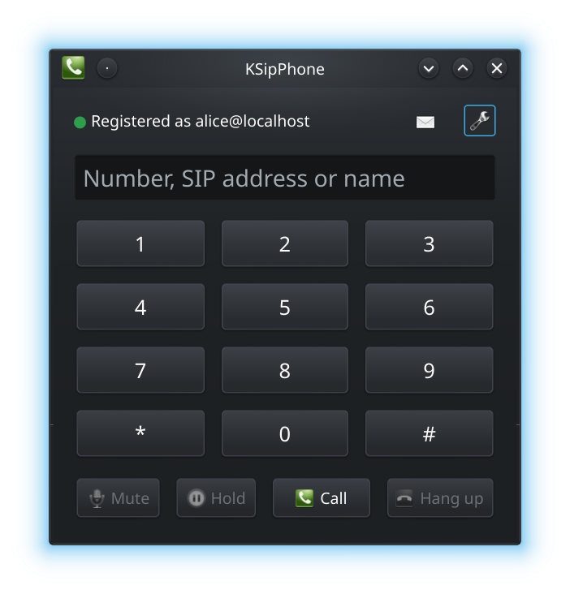
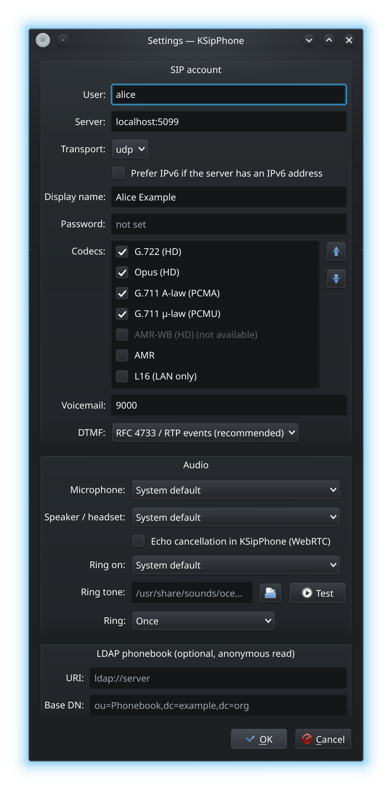

# KSipPhone

[](https://github.com/gongsearch/ksipphone/actions/workflows/build.yml)

A small, audio-only SIP softphone for KDE Plasma.

KSipPhone is a thin Qt 6 / KDE Frameworks 6 front end on top of the
[baresip](https://github.com/baresip/baresip) SIP stack. Baresip does all the SIP and
media work (registration, codecs, SRTP, PipeWire audio); KSipPhone runs it as a child
process, controls it over a loopback TCP connection (`ctrl_tcp` module) and integrates it into
the desktop: system tray, notifications, the system keychain, `tel:` links and an LDAP phonebook.
It is written for KDE Plasma but has no hard Plasma or D-Bus dependency of its own.

> Status: early (0.1). Developed and tested against Asterisk (PJSIP); not tested with many other
> servers yet. Issues and pull requests are welcome.

## Features

- **Tray application** (StatusNotifierItem): stays in the tray, the dialer window opens on click;
  starts hidden with `--minimized` (e.g. for autostart).
- **Incoming calls as KDE notifications** with *Accept* / *Decline*, caller name and photo.
- **Missed calls** time out into Plasma's notification history and keep a *Call back* button.
- **Voicemail**: message-waiting indicator (MWI) in window and tray, notification for new
  messages, one click to call the mailbox.
- **LDAP phonebook** (anonymous, read-only): search by name or number while typing,
  caller/callee name and `jpegPhoto` lookup for incoming and outgoing calls.
- **Address book of the computer** as second source after LDAP: KDE (KPeople, incl. phone
  contacts via KDE Connect), GNOME / Evolution, macOS Contacts. Results sorted alphabetically,
  name format *First Last* or *Last, First*, icons for source and number type.
- **Call transfer**: blind, or attended (consult the target first, then connect or go back).
- **Presence of internal extensions**: a list next to the keypad shows free / busy / offline;
  click to call, during a call click to transfer (see *Presence with Asterisk* below).
- **HD indicator**: shows the negotiated codec (HD badge for G.722 / Opus) and a call timer.
- **Audio**: choose microphone, speaker/headset and a separate ring device (PipeWire nodes);
  any sound file as ring tone, ringing once or continuously; optional WebRTC echo cancellation
  (leave it off if PipeWire already cancels echo).
- **Keypad / DTMF** (RFC 4733, SIP INFO or automatic), mute, hold.
- **`tel:`, `sip:`, `sips:`, `callto:` URL handler**, single instance (a click on a phone number
  dials in the running instance).
- **Password in the system keychain** (QtKeychain: KWallet / Secret Service, Windows Credential
  Manager, macOS Keychain), never written to disk by KSipPhone.
- **IPv6**: optionally prefer the server's IPv6 address.

Not (yet) supported: video, chat, own presence status, multiple accounts, conference.

## Requirements

- Qt ≥ 6.6: Core, Gui, Widgets, Concurrent, Network, Multimedia
- KDE Frameworks ≥ 6.0: CoreAddons, I18n, Config, Notifications, StatusNotifierItem,
  WidgetsAddons; extra-cmake-modules (optional: Wallet, to migrate passwords from 0.1)
- [QtKeychain](https://github.com/frankosterfeld/qtkeychain) for Qt 6
- OpenLDAP client library (`libldap`)
- **baresip ≥ 4** with the modules `ctrl_tcp`, `menu`, `g711`, `g722`, `opus`, `auconv`,
  `auresamp`, `srtp`, `mwi` and the platform's audio driver (`pipewire` on Linux; `wasapi` /
  `audiounit` on Windows / macOS), optional `webrtc_aec`

On Arch Linux:

```sh
sudo pacman -S --needed baresip cmake extra-cmake-modules ninja qt6-base qt6-multimedia qtkeychain-qt6 \
    kstatusnotifieritem knotifications kconfig ki18n kcoreaddons kwidgetsaddons libldap
```

## Build and install

```sh
cmake -S . -B build -G Ninja -DCMAKE_BUILD_TYPE=RelWithDebInfo -DCMAKE_INSTALL_PREFIX=$HOME/.local
ninja -C build install
```

This installs the binary, the desktop file (with the URL handlers) and the notification
configuration. After a user-local install run `kbuildsycoca6` once so Plasma finds the app.

To make KSipPhone the handler for phone links:

```sh
for s in tel sip sips callto; do xdg-mime default io.github.gongsearch.KSipPhone.desktop x-scheme-handler/$s; done
```

Autostart (hidden in the tray): add `ksipphone --minimized` in *System Settings → Autostart*.

## Configuration

Everything is set in the settings dialog (gear icon) and stored in `~/.config/ksipphonerc`;
the SIP password goes to the system keychain (service *KSipPhone*).

| Setting | Notes |
|---|---|
| User, server, transport | `sip:user@server;transport=udp|tcp|tls`; server may be `host:port` |
| Prefer IPv6 | registers via the server's IPv6 address if its name has one |
| Codecs | preference order, e.g. `G722,PCMA,PCMU,opus` |
| Voicemail | number to dial for the mailbox |
| Extensions | internal extensions shown with presence, e.g. `100, 1000, 2000` |
| DTMF | must match the server (Asterisk `dtmf_mode`) |
| Audio devices | as listed by Qt (PipeWire nodes on Linux), or system default |
| Ring tone | sound file, once or continuously, on its own device |
| LDAP | `ldap://host` and base DN; anonymous read of `cn`, `telephoneNumber`, `mobile`, `homePhone`, `jpegPhoto` |

### Presence with Asterisk

KSipPhone subscribes the event package `presence` (PIDF) for each extension. Asterisk (PJSIP) needs:

- a hint per extension in the endpoint's context, e.g. `exten => 100,hint,PJSIP/100`
- the modules `res_pjsip_exten_state` (needs `res_pjsip_outbound_publish`),
  `res_pjsip_pidf_body_generator` and `res_pjsip_pidf_eyebeam_body_supplement`
  (without the latter Asterisk reports *in use* only as a note and the extension looks free)
- `allow_subscribe=yes` on the endpoint (the default)

Check with `core show hints` (watchers) and `pjsip list subscriptions inbound`. A `489 Bad Event`
answer means the modules are missing. Asterisk reports *ringing* like *busy*.

Baresip's configuration is generated on every start in `~/.local/share/ksipphone/baresip/`;
the account (with password) only exists at runtime.

Where baresip lives is set at build time (`-DBARESIP_MODULE_PATH=…`, `-DBARESIP_SHARE_PATH=…`)
or at run time with the environment variables `KSIPPHONE_BARESIP` (executable),
`KSIPPHONE_BARESIP_MODULES` and `KSIPPHONE_BARESIP_SHARE`.

Security note: baresip's `ctrl_tcp` has no authentication. KSipPhone binds it to a random port
on `127.0.0.1` only, but on a multi-user machine other local users could reach that port while
KSipPhone runs.

## Translations

KSipPhone uses KDE's gettext-based i18n. Available: German (`po/de`).
After changing user-visible strings run `scripts/update-translations.sh` to update
`po/ksipphone.pot` and merge it into all languages. A new language is a copy of the
template as `po/<lang>/ksipphone.po`; pull requests are welcome.

## Screenshots

 

## License

MIT, see [LICENSE](LICENSE).
